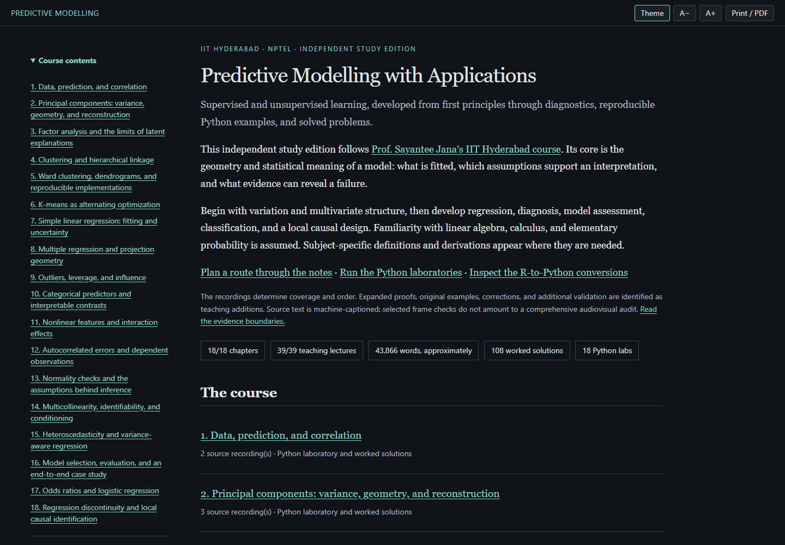

# Predictive Modelling with Applications — an independent study edition

**[Read the complete textbook](https://az9713.github.io/nptel-predictive-modelling-notes/)**

[](https://az9713.github.io/nptel-predictive-modelling-notes/)

An independent rewrite and expansion of **Prof. Sayantee Jana's IIT Hyderabad
NPTEL course**, *Predictive Modelling with Applications: Supervised and
Unsupervised Learning*. The [official course](https://nptel.ac.in/courses/106106850)
and [lecture playlist](https://www.youtube.com/playlist?list=PLyqSpQzTE6M-GrmRMG-WQJpnPzpd0qcO3)
provide the teaching spine. The source map restores the official teaching order
because the supplied playlist is shuffled. IIT Madras coordinates NPTEL; the
teaching institution for this course is IIT Hyderabad.

## What is included

- **18 chapters covering all 39 teaching recordings**, plus a mapped orientation.
- Approximately **43,866 words**, with explicit assumptions, derivations,
  worked examples, corrections and source timestamps.
- **108 exercises with complete solutions** and **18 executable Python labs**,
  with full source and recorded output embedded in the reader.
- Python implementations for **all 79 inventoried R example groups**, including
  DIANA, bisecting k-means, NbClust's 26 default indices and Hartigan–Wong k-means.
- An offline reader with bundled MathJax, dark/light themes, text sizing, chapter
  search, expandable solutions, code copying and print/PDF output.

[Study guide](https://az9713.github.io/nptel-predictive-modelling-notes/study-guide.html) ·
[Source map](https://az9713.github.io/nptel-predictive-modelling-notes/source-map.html) ·
[R-to-Python conversions](https://az9713.github.io/nptel-predictive-modelling-notes/python-conversions.html) ·
[Notation](https://az9713.github.io/nptel-predictive-modelling-notes/notation.html) ·
[Python laboratory](https://az9713.github.io/nptel-predictive-modelling-notes/laboratory.html) ·
[Evidence and limitations](https://az9713.github.io/nptel-predictive-modelling-notes/about.html)

## Read the chapters online

| Chapter | Topic |
|---|---|
| 1 | [Data, prediction, and correlation](https://az9713.github.io/nptel-predictive-modelling-notes/chapter-01.html) |
| 2 | [Principal components](https://az9713.github.io/nptel-predictive-modelling-notes/chapter-02.html) |
| 3 | [Factor analysis](https://az9713.github.io/nptel-predictive-modelling-notes/chapter-03.html) |
| 4 | [Clustering and hierarchical linkage](https://az9713.github.io/nptel-predictive-modelling-notes/chapter-04.html) |
| 5 | [Ward clustering and reproducible hierarchies](https://az9713.github.io/nptel-predictive-modelling-notes/chapter-05.html) |
| 6 | [K-means and choosing a partition](https://az9713.github.io/nptel-predictive-modelling-notes/chapter-06.html) |
| 7 | [Simple linear regression](https://az9713.github.io/nptel-predictive-modelling-notes/chapter-07.html) |
| 8 | [Multiple regression and projection geometry](https://az9713.github.io/nptel-predictive-modelling-notes/chapter-08.html) |
| 9 | [Outliers, leverage, and influence](https://az9713.github.io/nptel-predictive-modelling-notes/chapter-09.html) |
| 10 | [Categorical predictors](https://az9713.github.io/nptel-predictive-modelling-notes/chapter-10.html) |
| 11 | [Nonlinear features and interactions](https://az9713.github.io/nptel-predictive-modelling-notes/chapter-11.html) |
| 12 | [Autocorrelated errors](https://az9713.github.io/nptel-predictive-modelling-notes/chapter-12.html) |
| 13 | [Normality and inference](https://az9713.github.io/nptel-predictive-modelling-notes/chapter-13.html) |
| 14 | [Multicollinearity and conditioning](https://az9713.github.io/nptel-predictive-modelling-notes/chapter-14.html) |
| 15 | [Heteroscedasticity](https://az9713.github.io/nptel-predictive-modelling-notes/chapter-15.html) |
| 16 | [Model selection and evaluation](https://az9713.github.io/nptel-predictive-modelling-notes/chapter-16.html) |
| 17 | [Odds ratios and logistic regression](https://az9713.github.io/nptel-predictive-modelling-notes/chapter-17.html) |
| 18 | [Regression discontinuity](https://az9713.github.io/nptel-predictive-modelling-notes/chapter-18.html) |

## Read and run locally

Clone the repository or use **Code → Download ZIP**, extract it and open
`index.html`. Reading assets work offline; recordings and external references
require an internet connection. No R installation is required.

```sh
python -m pip install -r requirements-lock.txt
python code_lab.py
python code_lab.py 1
python tools/build_book.py
python tools/check_book.py
python tools/check_reader.py
python tools/check_export.py
```

`code_lab.py` lists available labs; supplying a chapter number runs that lab.
The verified environment uses Python 3.13, NumPy 2.2.6, SciPy 1.16.0,
pandas 2.3.3, scikit-learn 1.7.0 and statsmodels 0.15.0 on Windows AMD64.
See [the version lock](requirements-lock.txt) for the full direct dependency set.
Browser checks use Playwright with Google Chrome, or an installed Playwright
Chromium browser (`python -m playwright install chromium`). The export checker
builds a clean copy and runs every main lab using public inputs only.

## Review and verification

Every chapter has **two independent AI scientific review rounds**, accepted at
the current chapter-body digest. All 18 labs passed with saved-output agreement,
including from the clean export. All 26 reader pages passed offline desktop and
mobile checks. The clean rebuild reproduced every reader page byte for byte.
Finite numerical checks, scientific review, browser checks and publication
checks are separate evidence; they do not constitute formal proof verification
or human expert certification.

- [Content inventory](completion.json) and [review digest audit](validation/edition-checks.json).
- [R conversion ledger](validation/r-to-python-examples.json) and fresh-R comparison records in `validation/`.
- [Execution and link checks](validation/book-checks.json), [offline reader checks](validation/reader-checks.json), and [source-free export checks](validation/source-free-checks.json).
- [Production workflow](WORKFLOW.md) and [verification environment](validation/environment.json).

## Source coverage and reproduction limits

All 40 caption tracks, including the orientation, were read in full. Selected
frames resolved specific mathematical and code ambiguities; a complete
audiovisual audit is not claimed. Derivations, original examples, corrections
and additional numerical checks are teaching additions. A timestamp identifies
the related lecture discussion, not the origin of every equation beside it.

Every inventoried R method has a Python implementation. Exact lecture numbers
cannot be reproduced where the original insurance CSV, Toyota training subset,
or expenditure CSV was unavailable. Some source transformation/smoother options
and unshown random states remain unknown. Each case is explained in the
[conversion ledger](https://az9713.github.io/nptel-predictive-modelling-notes/python-conversions.html).
Same-input fresh R comparisons are distinguished from mathematical checks and
visible lecture-output comparisons.

Raw captions, recordings, source frames, downloaded package sources, private R
environments and internal acquisition logs are excluded. Public evidence records
retain the scope and limits of each check. The root-level HTML reader and its
supporting `assets/`, `labs/`, `tools/`, source metadata and validation records
follow the other NPTEL reading editions; GitHub Pages serves `main` at the root.

This is an independent educational publication with no institutional endorsement.
Recordings, datasets and cited work retain their respective attribution.
MathJax has its [bundled license](assets/mathjax-LICENSE); direct algorithm ports
retain their accompanying notices in `labs/`.
